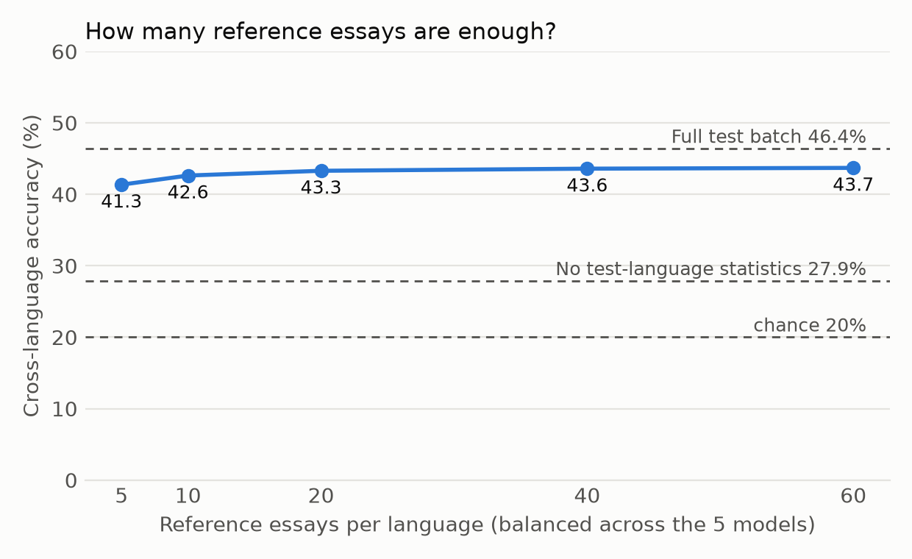

# Follow-up report

Run 2026-11-06 under `docs/followup_plan.md`, which was committed before the run. Same data and prompt-disjoint setup as pilot Experiment B, with 50 new prompt splits. Runtime was 20 seconds, with no API calls.

Baselines on these splits: no test-language statistics 27.9%, full test batch 46.4%, 60-essay reference set 43.7%.

## Main points
1. **Five reference essays are enough.** One essay per model per language recovers 73% of the gap, and ten recover 80%.
2. **The reference set mostly corrects for the language, not the model mix.** Lopsided references, and even a reference from a single model, still recover 67–76%.
3. **The features that need target-language statistics are the ones that differ most between languages,** led by character-bigram entropy and mean token length.
4. **Length matters, but not for the reference set's job.** Length control lowers every arm by about 10 points, yet the reference set still recovers 85% of the gap.

## F1. Reference size (rule: pass)

| Reference essays per language | 5 | 10 | 20 | 40 | 60 |
|---|---|---|---|---|---|
| Accuracy | 41.3% | 42.6% | 43.3% | 43.6% | 43.7% |
| Share of the gap recovered | 73% | 80% | 83% | 85% | 85% |

The pre-registered rule was that 10 essays should recover at least 50%. They recover 80%, so the paper may call the fix "cheap: about two essays per model".

## F2. Lopsided and incomplete reference sets

**(a) One dominant model** (d essays from it, 1 from each other model):

| d | 1 | 4 | 8 | 12 |
|---|---|---|---|---|
| Recovery | 73% | 76% | 75% | 75% |

At d = 12, accuracy depends on which model dominates: GPT 38.6%, Grok 39.9%, Claude 42.3%, DeepSeek 43.7%, Gemini 44.0%.

**(b) Reference from only some of the models:**

| Models in the reference | 1 | 2 | 3 | 4 | 5 |
|---|---|---|---|---|---|
| Recovery | 67% | 75% | 80% | 83% | 85% |

**Rule:** if a single-model reference recovered less than 50%, the paper would say the reference must cover every candidate. It recovers 67%, so the rule does not apply, but coverage still helps.
- Which single model matters: DeepSeek or Gemini alone reach 43.6% and 43.2%, while GPT or Grok alone reach only 36.1% and 37.2%.

**What it means:** most of the gap is the language shifting the features, such as average word length and character statistics, not the model mix. A reference set from any of these models fixes most of it.

That raises a natural next question, which was not pre-registered here: can the reference come from a model outside the candidate set, such as a cheap open model? The new-essay study can test this.

## F3. Clue table

The drop column is the accuracy lost when only that feature uses source-language statistics instead of the reference set. The shift column is the average distance between languages, in source-language standard deviations.

| Feature | Accuracy drop (points) | Language shift (SD) |
|---|---|---|
| Character-bigram entropy | 11.5 | 7.6 |
| Mean token length | 9.9 | 23.1 |
| Function-word ratio | 5.6 | 4.2 |
| Hapax rate | 4.5 | 3.5 |
| Zipf slope | 4.5 | 3.7 |
| MATTR | 4.1 | 3.5 |
| Subordination rate | 3.5 | 2.8 |
| Commas per 1k | 2.5 | 1.2 |
| Colons per 1k | 1.8 | 1.0 |
| Connective rate | 1.8 | 2.0 |
| 11 other features (sentence length, layout, other punctuation, questions, digits, first person, burstiness) | 1.1 or less | 0.2 to 1.7 |

**What it means:** the lexical and character features carry signal but are mostly measuring the language, so they need target-language statistics. Layout and punctuation features, including paragraph count, carry their signal across languages largely unaided. Full table: `followup_clue_table.csv`.

## F4. Length control (rule: fail, reported as written)

| Normalisation source | Plain features | Length-residualised |
|---|---|---|
| None | 27.9% | 25.0% |
| Reference | 43.7% | 33.0% |
| Batch | 46.4% | 34.4% |

**Rule:** the reference arm needed to stay within 3 points after length control. It fell 10.7 points, so the rule fails.
- **Read correctly:** length control lowers every arm, mostly the reference and batch arms, so length carries real model signal.
- **Not pre-registered:** under length control, the reference set still recovers 85% of the gap, the same share as without it. Length explains part of the accuracy, not the reference-set effect.
- **The rule was worded too broadly.** It tested the absolute level instead of the recovery. The paper should report both numbers.

## Caveats
- **Same date and models:** all reference essays come from the same models and collection date as the test essays. The new essays test a later date and outside models.
- **Prompt splits reuse the same 12 prompts,** so the splits are not independent. Use prompt-clustered intervals in the paper.
- **The clue table is one feature at a time.** Correlated features (MATTR, hapax rate and Zipf slope) can share credit.
- **Language shifts are measured on split 0 only.**
