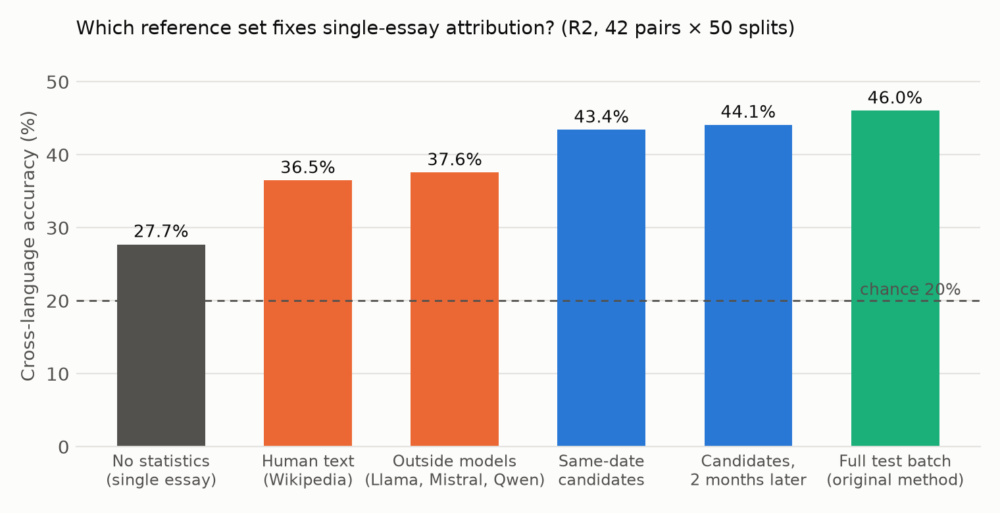
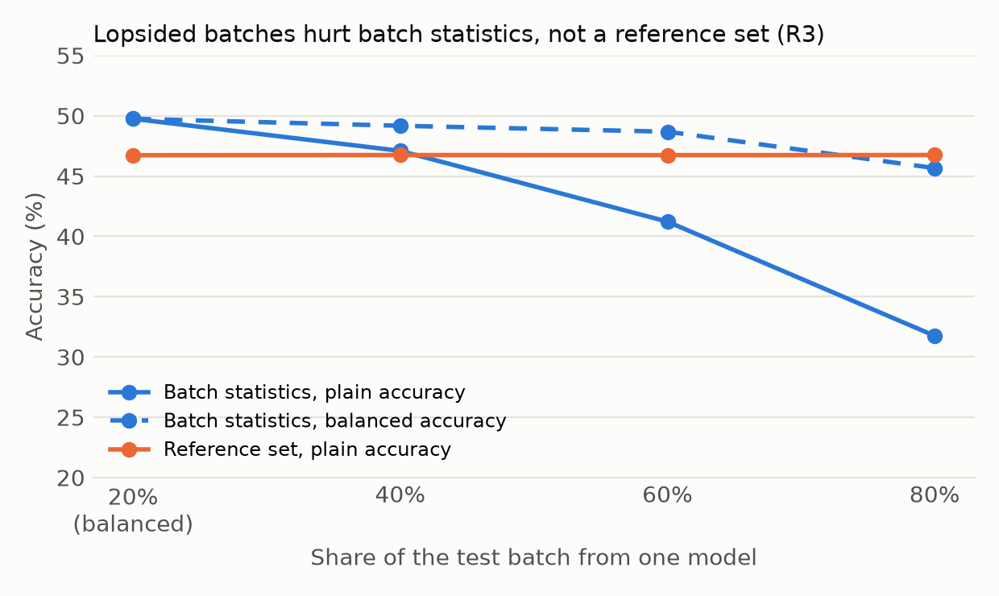

# Main study report

Run 2026-11-07. Pre-registered in `docs/main_study_plan.md` (addenda 1–2). The analysis code (`src/main_study.py`) was committed before any real result existed.

**Data**
- LangLLM's 839 essays (original).
- **N1:** 420 new essays from the same five models, on 12 new prompts, about two months later. All passed validation.
- **N2:** 251 essays from three outside models in Ollama. One cell is missing: Llama refused the Chinese stratospheric-aerosol prompt in all four attempts.
- **N3:** 588 Wikipedia excerpts.
- **Features:** computed with LangLLM's own extractor at Stanza 1.14.0. A check on 35 of LangLLM's essays matched `features.csv` exactly (735 of 735 values).
- **Runtime:** 130 s on a MacBook.

## Hypotheses (prompt-clustered bootstrap, 1,000 resamples, Holm across H1–H5)

| | Claim | Estimate | 95% CI | Holm p | Holds? |
|---|---|---|---|---|---|
| H1 | R1: single-essay accuracy is at least 10 points below batch | **20.5 points** | 18.2 – 22.5 | < 0.001 | **yes** |
| H2 | R2: the candidate reference from two months later recovers at least 50% of the gap | **89%** | 85 – 93% | < 0.001 | **yes** |
| H3 | R2: the pooled outside-model reference recovers at least 50% | 54% | 47 – 61% | 0.30 | no |
| H4 | R3: plain accuracy at an 80% mix is at least 10 points below a balanced batch | **18.0 points** | 16.2 – 19.9 | < 0.001 | **yes** |
| H5 | R2: a human (Wikipedia) reference recovers at least 50% | 48% | 43 – 54% | 0.75 | no |

H3 and H5 are not supported. Both recover about half the gap: real, but not enough to clear the bar with confidence.

## R1: replication on new prompts, collected two months later
Training is on language A's original essays; testing is on language B's N1 essays (42 pairs).

| Arm | Accuracy | Recovery of gap |
|---|---|---|
| No test-language statistics (single essay) | 28.7% | — |
| Reference: B's original essays (two months older) | 46.7% | 88% |
| Reference: outside models, pooled | 38.5% | 48% |
| Reference: Wikipedia | 36.4% | 38% |
| Full test batch (original method) | 49.1% | 100% |

- **The collapse replicates.** A single essay gets close to chance (20%) on new prompts and a new date, just as in the pilot (27.4%).
- **An older reference still works.** A reference from two months earlier recovers most of the gap.
- **Reference size:** 5 / 10 / 20 essays recover 72 / 81 / 84% (original reference), and 42 / 47 / 48% (outside models).

## R2: reference sets on LangLLM's own test essays (prompt-disjoint, 50 splits)
None 27.7%, batch 46.0%.

| Reference set | Accuracy | Recovery |
|---|---|---|
| Same date (LangLLM, other prompts) | 43.4% | 86% |
| **Candidates, two months later (N1)** | **44.1%** | **89%** |
| Outside models, pooled | 37.6% | 54% |
| Llama / Mistral / Qwen alone | 35.0 / 35.8 / 37.5% | 40 / 44 / 53% |
| Wikipedia (human) | 36.5% | 48% |

- **Size curve for N1:** 5 / 10 / 20 essays recover 75 / 83 / 87%.
- **The fix doesn't decay over two months.** The later candidate reference is as good as the same-date one.
- **Any text helps, but text from the right models helps most.** References from the candidates beat references from other models or humans by about 7 points.

## R3: lopsided test batches (batches of 15 from N1)

| Dominant share | Batch, plain | Batch, balanced | Dominant model's recall | Reference, plain |
|---|---|---|---|---|
| 20% (balanced) | 49.8% | 49.8% | 49.7% | 46.7% |
| 40% | 47.1% | 49.2% | 41.3% | 46.7% |
| 60% | 41.2% | 48.7% | 34.2% | 46.7% |
| 80% | 31.8% | 45.7% | 26.7% | 46.7% |

- **Batch statistics break under imbalance.** Centring on a lopsided batch pulls the dominant model's essays toward "average", and its recall falls to 27%.
- **A reference set is unaffected.** It doesn't depend on the batch, and it beats batch statistics once one model makes up 40% or more.
- **This held for every dominant model,** with 80% plain accuracy between 27.7% (GPT) and 36.7% (DeepSeek).
- **H4 is now confirmatory.** In the pilot this was only exploratory.

## R4: which features carry the language shift, and does length matter?
- **Clue table:** normalising one feature with source-language statistics costs the most accuracy for bigram_entropy (11–12 points), mean_token_len (10), func_word_ratio, zipf_slope and hapax_rate. This is the same order as the pilot, for both the original and N1 references. These lexical and character features differ most between languages, so they need the target-language reference most.
- **Length control:** with length-residualised features, accuracy is 24.8% with no statistics, 32.8% with the original reference, 34.1% with N1, 31.6% with N2 and 34.3% with the batch. Every arm drops by 9–12 points but keeps the same ordering, so the reference effect isn't just length.

## Reference-free features (descriptive)
Using only the 12 features with a small language shift and no target-language statistics gives 35.7% (R1) and 34.3% (R2). That's better than the full 21 features with no statistics (28.7% / 27.7%), but well below any candidate reference (43–47%).

## Caveats
- **The outside models** are 4-bit local models (addendum 2), smaller than the candidates. A stronger outside set might do better, so H3 is a statement about these three models.
- **Wikipedia** is expository, not persuasive. Its 48% recovery mixes language shift with genre shift.
- **Bootstrap:** it resamples test prompts but holds the normalisation statistics fixed, so its intervals are somewhat narrow.
- **R3 batch size:** 15, not the pilot's 20, because N1 has 12 essays per model per language.
- **One test-language set per date:** N1 is a single collection, two months after LangLLM's.

## Headline for the paper
Cross-language LLM attribution with LangLLM's features silently depends on normalising over the whole test batch.
- **One essay at a time:** accuracy falls to near chance (−20 points). This replicates on new prompts collected two months later.
- **Lopsided batches:** plain accuracy falls by 18 points.
- **The fix:** a small unlabeled reference set of essays from the candidate models in the target language recovers 86–89% of the gap. It still works with a reference collected two months apart, and 10 essays already recover over 80%.
- **Other reference sources:** essays from other models or from human writers recover only about half.

## Exploratory additions (addendum 3, added after the main results)

**E1: shorter texts.** This is the R1 setup, with training and test essays both cut to N word-equivalents. The reference set is B's original essays, cut to the same length.

| Length | None | Reference | Batch | Recovery |
|---|---|---|---|---|
| 50 | 26.2% | 30.7% | 30.1% | (gap 4 points, not meaningful) |
| 100 | 26.6% | 32.7% | 34.8% | 75% |
| 200 | 27.0% | 33.3% | 35.7% | 72% |
| Full (about 350) | 28.7% | 46.7% | 49.1% | 88% |

Below about 200 words, even the batch gets little accuracy. The reference set still recovers most of the remaining gap.

**E2: multilingual-e5-base embeddings** (768 dimensions, same classifier and arms).

| Setup | None | Candidate reference | Outside reference | Human reference | Batch |
|---|---|---|---|---|---|
| R1 (new essays) | 38.5% | 44.9% (67%) | 40.0% (17%) | 38.1% (−3%) | 48.1% |
| R2 (original splits) | 35.4% | N1 43.0% (68%); same-date 41.3% (52%) | 39.2% (34%) | 38.3% (26%) | 46.6% |

The batch dependence also appears with a neural representation, but it is smaller (a gap of about 10 points rather than 20). Only candidate references recover much of it.

## Robustness checks after outside review (addendum 4)
- **E2b, embeddings with E5's official settings** (`query:` prefix, L2-normalised). R1: none 38.5%, candidate reference 46.2% (81% recovery), outside 39.6%, human 39.5%, batch 47.9%. R2: none 35.3%, N1 reference 43.2% (65%), batch 47.4%. The usual pipeline (logistic regression on L2 vectors, no scaling) gives 34.1% (R1) and 32.6% (R2), so the gap is not caused by our z-scoring. This supersedes E2 (`passage:`), which reached the same conclusions.
- **R3b, imbalance isolation.** With the evaluation essays fixed and balanced and only the normalisation sample lopsided, accuracy goes 48.3% → 45.9% from 20% to 80%, while the dominant model's recall goes 48.2% → 26.7%. Lopsided statistics mainly hurt the over-represented model. R3's 18-point plain-accuracy drop arises because that model supplies most of the test batch.
- **Reference-sampling spread (R1, 200 draws).** With 5 essays the 95% range is 39.8–46.7%; with 10, 43.1–47.5% (minimum 42.3%); with 20, 44.0–47.6%. Every draw stays well above none (28.7%).
- **Per test language (R1), recovery:** en 94%, es 76%, zh 95%, ru 88%, ja 88%, tr >100% (reference beats batch), hi 72%.
