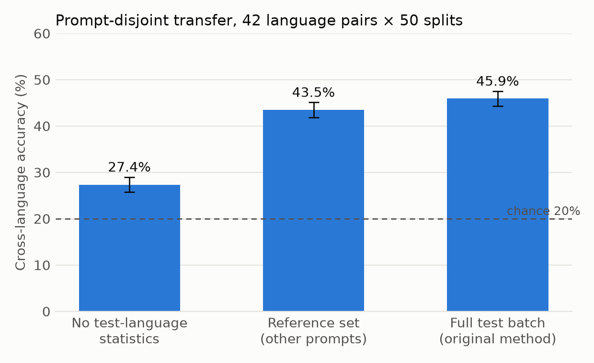
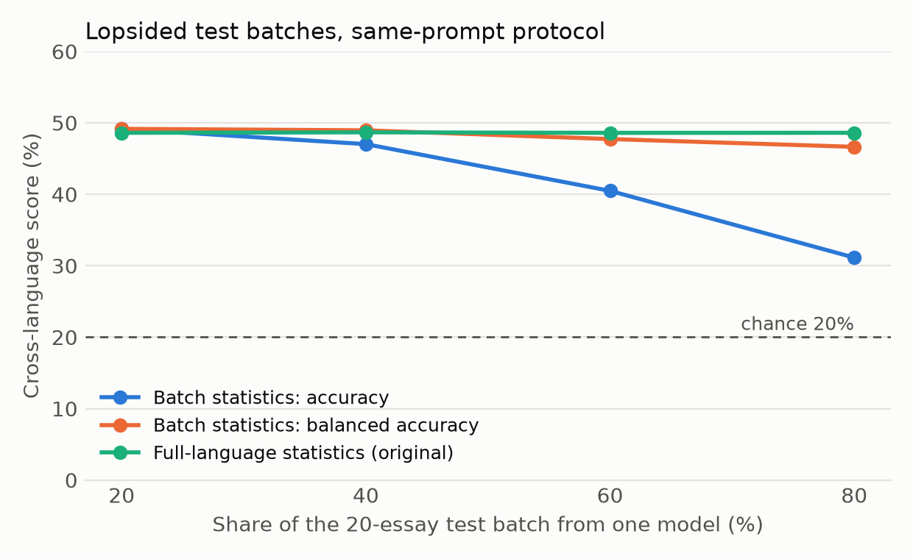

# Pilot report

Run 2026-11-06 on LangLLM's released features (commit 06109dc; 839 essays, 21 features, 5 models, 7 languages). The rules were fixed in `docs/pilot_plan.md` and committed before the run. Total runtime was 40 seconds on a MacBook, with no API calls.

## Decision: go

The batch effect is real and large. A reference set recovers most of it. Rejecting unknown models does not work with these features and is now a short negative result rather than a headline.

## Results

**Step 0, reproduction (gate G2: pass).** Our code reproduces the published transfer matrix exactly: 0.4861 mean off-diagonal, with every cell matching.

**Experiment B, the main result (prompt-disjoint, 42 language pairs × 50 prompt splits).**

| How the test language is normalised | Accuracy | SD across splits |
|---|---|---|
| No test-language statistics (the single-essay case) | 27.4% | 1.6 |
| Reference set: 60 unlabeled essays per language, on other prompts | 43.5% | 1.6 |
| Full balanced test batch (original method) | 45.9% | 1.6 |

- Without test-language statistics, accuracy falls 18.6 points, to just above chance (20%).
- The reference set recovers 87% of that gap (gate G3b: pass).
- The reference set beat no statistics in all 50 splits, and stayed below the full batch in all 50.
- The pattern holds for every test language: reference set 41.7–47.5%, no statistics 23.6–33.6%.

**Experiment A (same-prompt protocol, 200 draws per condition).**

| Test batch | Balanced accuracy, batch statistics | Same essays, original full-language statistics |
|---|---|---|
| Balanced, 20 essays | 49.2% | 48.6% |
| 80% from one model | 46.6% | 48.6% |
| Balanced, 5 essays | 51.5% | 48.9% |
| No statistics (single essay) | 30.0% | — |

- **Pre-registered imbalance test:** balanced accuracy dropped 2.5 points at an 80% mix, which is under the 3-point bar. Gate G3a still passes on Experiment B, but imbalance alone did not meet its own pre-registered criterion.
- **Exploratory, not pre-registered:** plain accuracy at an 80% mix falls from 49% to 31%, because the dominant model's essays get centred toward "average" and mislabelled. The loss is concentrated where the dominant model is GPT (42.7% balanced) or Grok (44.0%), and absent for DeepSeek and Gemini. This should be pre-registered before it is reported as a finding.
- **Batch size barely matters:** even 5 essays, one per model, work as well as the full batch. The problem is the batch's composition, not its size.

**Experiment C, unknown models (gate G3c: weak).** Pooled AUROC is 0.49 for the reference arm, 0.50 with no statistics, and 0.53 with the full batch, where 0.5 is guessing.
- By held-out model, AUROC ranged from 0.42 (Grok) to 0.59 (DeepSeek).
- The classifier is not less confident on an unseen model's essays, so "1 − max probability" cannot flag them.

## Caveats
- **The reference set is still balanced across the five candidate models.** In practice you would generate it yourself from the candidates, which is what the main study's new essays test.
- **Same collection date:** the reference essays come from the same date as the test essays. Whether the reference still works on essays collected about nine weeks later is an open question.
- **Spreads aren't confidence intervals:** the SDs above are across splits that reuse the same essays. Proper prompt-clustered bootstrap intervals come in the main study.
- **Two effects are tangled:** shared prompts versus the half-size training set. The original 48.6% falls to 45.9% in Experiment B, but that drop mixes removing shared prompts with training on only 6 of the 12 prompts.
- **Imputation uses the whole language:** missing values are filled with the within-language median, a small use of whole-language statistics. It affects very few values.

## Next steps
1. **Reference-size curve (free, existing data):** how few reference essays per language are enough (5, 10, 20, 40, 60)?
2. **Lopsided reference sets:** does the reference set itself need to be balanced?
3. **Pre-register the plain-accuracy imbalance analysis** and the per-model breakdown.
4. **Clue table:** which features need test-language statistics.
5. **Length control,** applied without whole-language statistics.
6. **Then the new essays:** a reference set collected from the candidate models at a later date (about $6).
